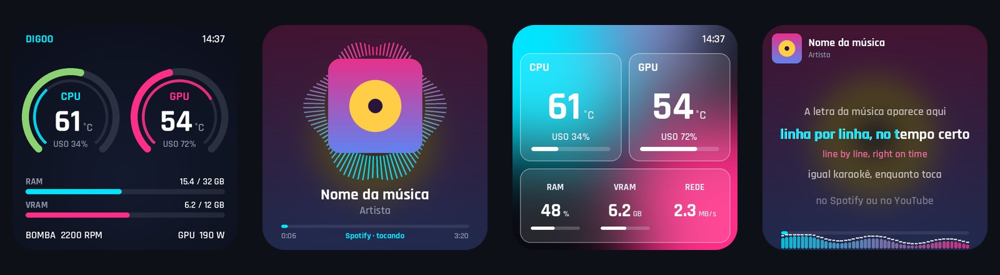
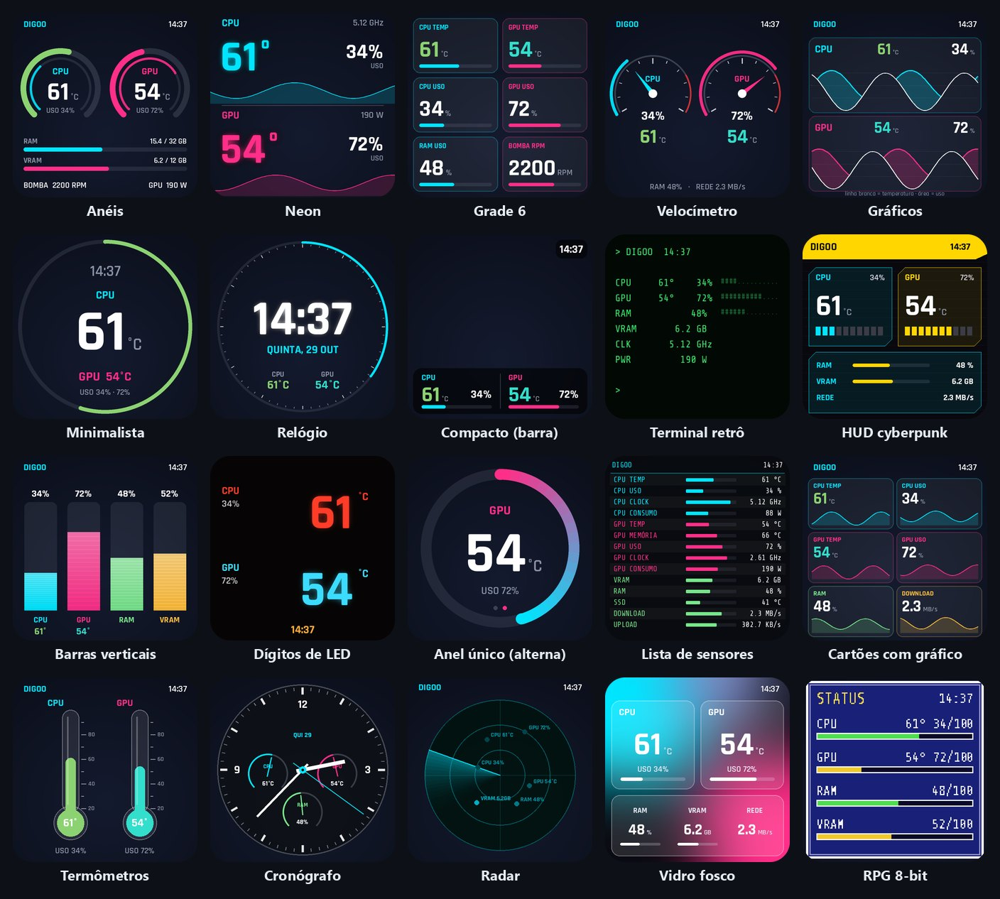
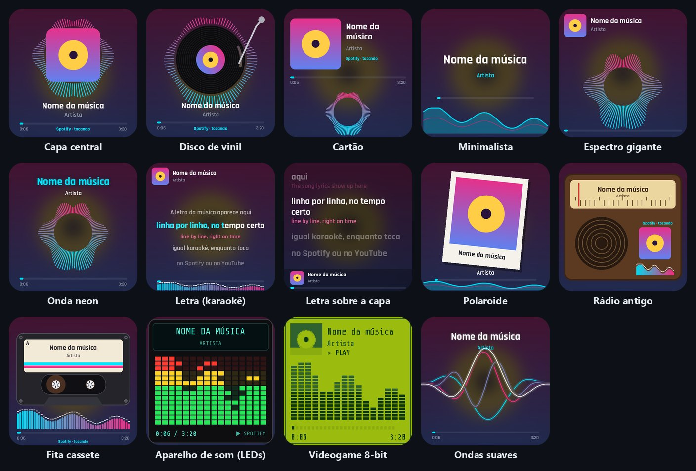

# Digoo LCD Studio — software para water cooler Digoo com tela LCD

**Programa grátis para a telinha do water cooler Digoo** (e de outros watercoolers com tela LCD que usam o painel
**HONGTAI / LOVINGCOOL "MONITOR"**, USB `33c3:7791`, `7788` ou `7792`). O water cooler Digoo vem sem software, ou
com um programa fraco; este aqui mostra a **temperatura da CPU e da GPU**, coloca **GIF, vídeo e foto** na tela,
puxa wallpapers do **Wallpaper Engine** e mostra a **música do Spotify/YouTube com a letra e a tradução**.
Windows 10/11, código aberto (MIT).

**[⬇ Baixar a última versão (Windows)](https://github.com/Rubinho82/digoo-lcd-studio/releases/latest)** ·
[Site do projeto](https://rubinho82.github.io/digoo-lcd-studio/)



> **English:** free **Digoo water cooler software** for the AIO's LCD screen (HONGTAI/LOVINGCOOL panel, USB
> 33c3:7791). Shows CPU/GPU temperature, plays GIFs and videos, Wallpaper Engine Workshop, Spotify/YouTube
> "now playing" with synced lyrics and translation. Windows 10/11. The interface is in Portuguese.

## Como usar

1. Baixe o zip em **[Releases](https://github.com/Rubinho82/digoo-lcd-studio/releases/latest)** e extraia em
   qualquer pasta.
2. Abra o **DigooLCD.exe** com o water cooler ligado no USB. A tela é achada sozinha.
3. Escolha um tema na aba **Temas**. Para ver a temperatura da CPU, instale o driver grátis **PawnIO** pelo botão
   na aba **Sensores**.

Não precisa instalar Python nem nada. Para abrir junto com o Windows, marque "Iniciar junto com o Windows" na aba Configurações.

## Dúvidas comuns

**Meu water cooler Digoo veio sem software. Esse serve?** Serve se a tela aparecer no Gerenciador de Dispositivos
como porta COM com o ID `33c3:7791` (ou `7788`/`7792`). É o painel HONGTAI que vem nos watercoolers Digoo,
LovingCool e de outras marcas.

**A tela voltou para a imagem de fábrica.** Isso acontece quando nenhum programa está mandando imagem. Deixe o
Digoo LCD Studio aberto (ele fica na bandeja, perto do relógio) ou ative o início com o Windows.

**Não aparece a temperatura da CPU.** Instale o PawnIO pela aba Sensores (é o driver que o LibreHardwareMonitor
usa para ler a CPU).

**Dá para colocar GIF ou vídeo?** Sim: arraste o arquivo para a janela do programa ou procure na aba Biblioteca (GIPHY, anime,
Workshop do Wallpaper Engine). Dá para deixar a temperatura por cima do vídeo.

**Como pôr a letra da música?** Na aba Música, escolha o modelo *Letra (karaokê)*. A tradução liga na mesma aba.

## Temas





## O que faz

| | |
|---|---|
| **Painel de sensores** | 20 temas: Anéis, Neon, Grade 6, Velocímetro, Gráficos, Minimalista, Relógio, Compacto, Terminal retrô, HUD cyberpunk, Barras verticais, Dígitos de LED, Anel único (alterna CPU/GPU), Lista de sensores, Cartões com gráfico, Termômetros, Cronógrafo, Radar, Vidro fosco, RPG 8-bit |
| **Personalizar** | cores (ou paletas prontas), 6 fontes, °C/°F, relógio (hora, segundos, data, dia da semana), título opcional, imagem de fundo |
| **Fotos, GIFs e vídeos** | playlist com velocidade ajustável; vídeos/GIFs convertidos uma vez em quadros prontos (tocar ≈ 1% de CPU) |
| **Biblioteca** | **Workshop do Wallpaper Engine** (navega, assina e baixa pela sua Steam, sem senha), GIPHY/Tenor (chave grátis), anime, Wikimedia; prévia animada antes de baixar; 8 efeitos animados gerados ao vivo |
| **Tema por cima da mídia** | qualquer tema por cima do vídeo/foto, com transparência e escurecimento |
| **Camadas** | mover e redimensionar o tema e a música (arrastar na prévia, rodinha = tamanho) ou modos prontos: encaixe automático, música em pílula |
| **Música** | "tocando agora" do Windows (Spotify, YouTube no navegador…) com capa, título e tempo + ondas do som do PC (sem microfone); 14 modelos: Capa central, Disco de vinil, Cartão, Minimalista, Espectro gigante, Onda neon, **Letra (karaokê)**, **Letra sobre a capa**, Polaroide, Rádio antigo, Fita cassete, Aparelho de som (LEDs), Videogame 8-bit, Ondas suaves; cores automáticas da capa |
| **Letras sincronizadas** | a letra da música que está tocando, linha por linha no tempo certo (karaokê), buscada na [LRCLIB](https://lrclib.net) (grátis, sem cadastro) e guardada em cache; funciona no Spotify e em clipes do YouTube (o título "Artista - Música (Official Video)" é limpo sozinho); ajuste fino de ±5 s |
| **Tradução da letra** | a tradução aparece embaixo de cada linha (ou só a tradução), para português, inglês, espanhol, francês, italiano, alemão, japonês ou coreano; tradutores: MyMemory (grátis, sem cadastro, limite diário), DeepL (chave grátis, muito boa) ou Claude (IA, chave paga, a mais natural — traduz sentido e gíria); cada música é traduzida uma vez e fica em cache |
| **Espelhar tela** | um monitor inteiro ou uma região |
| **Sensores** | CPU, GPU (NVIDIA/AMD/Intel), RAM, VRAM, SSDs, rede, ventoinhas — via LibreHardwareMonitor; ventoinha da GPU controlável (volta ao automático ao sair, 100% se passar de 83 °C) |
| **Sistema** | bandeja, início com o Windows sem UAC (tarefa agendada), modo noturno, brilho por software, reconexão automática |

A temperatura da CPU e as ventoinhas da placa-mãe precisam do driver gratuito
[PawnIO](https://github.com/namazso/PawnIO.Setup) (botão na aba Sensores).

## Instalar / compilar

Precisa de **Python 3.10+**, **.NET SDK 8** e as libs do `requirements.txt`. As chaves do DeepL/Claude ficam só no seu PC (`%APPDATA%\DigooLCD\config.json`).

```bash
build.bat
```

Gera `dist\DigooLCD\DigooLCD.exe`. Para rodar do código: `python DigooLCD.pyw`.
Diagnóstico: `DigooLCD.exe --diagnostico` (grava `%APPDATA%\DigooLCD\diagnostico.txt`).

## Estrutura

| Arquivo | Função |
|---|---|
| `digoo_lcd/protocol.py` | protocolo serial da tela |
| `digoo_lcd/engine.py` | motor: conecta, desenha, camadas, envia, mantém a tela no modo ao vivo |
| `digoo_lcd/render.py` / `themes_extra.py` / `themes_display.py` | temas do painel (e camadas transparentes) |
| `digoo_lcd/music.py` / `music_extra.py` | espectro, "tocando agora" e modelos do tema Música |
| `digoo_lcd/lyrics.py` | letras sincronizadas (LRCLIB) |
| `digoo_lcd/translate.py` | tradução das letras (MyMemory, DeepL, Claude) |
| `digoo_lcd/textdraw.py` | texto com fonte reserva do Windows (♪, japonês, coreano, emoji…) |
| `digoo_lcd/sources.py` / `videocache.py` | playlist, espelho, quadros prontos em cache |
| `digoo_lcd/library.py` / `steam_ws.py` | biblioteca online e Workshop do Wallpaper Engine |
| `digoo_lcd/gui.py` / `gui_library.py` | interface (PySide6) |
| `sensorhelper/` | leitor .NET: sensores (LibreHardwareMonitor), som do PC (NAudio) e mídia do Windows |

## Protocolo (resumo)

- Comando: `55 AA | len(2, LE) | opcode | payload | soma(2, LE)`, `len = payload + 7`.
  `0x06` info (JSON), `0x11` keepalive (a cada ~1,5 s), `0x03` brilho, `0x21` fechar.
- Quadro (fw > 2.8): `len_jpeg(4, LE) | jpeg | soma(2, LE)`.
- **Só JPEG 4:2:0** — o decodificador da tela mostra 4:4:4 pixelado.
- O painel TXW818-ST7701S 4" (fw ≤ 3.1) engasga com quadros grandes: até 50 KB e 25 fps.
- Neste modelo a luz de fundo ignora o `0x03`; o brilho é feito escurecendo a imagem.
- `FF D9 FF D9 00 00 00 00` aborta um quadro pela metade.

## Créditos

Protocolo baseado na engenharia reversa de [GOG1071/hongtai-panel](https://github.com/GOG1071/hongtai-panel).
Sensores: [LibreHardwareMonitor](https://github.com/LibreHardwareMonitor/LibreHardwareMonitor) (MPL-2.0).
Áudio: [NAudio](https://github.com/naudio/NAudio). Letras: [LRCLIB](https://lrclib.net) (as letras não são distribuídas aqui; são buscadas na hora). Fontes Orbitron, Rajdhani, Exo 2 e Share Tech Mono (SIL OFL).
O Workshop usa a `steam_api64.dll` da sua instalação do Wallpaper Engine (não é distribuída aqui).
Projeto independente, sem ligação com Digoo, HONGTAI, Valve ou Wallpaper Engine.

Licença: MIT.
